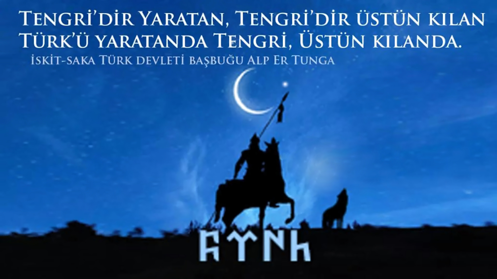

# Windows 11 ALP ER TUNGA

**Windows 11 Pro 23H2 · 22631.2428 · Türkçe · x64 · r1**

Kaynaklar ve ISO hashleri yayımlandı. **Büyük ISO için Archive bağlantısı henüz eklenmedi.** Bu revizyonun kurulum testi bekleniyor; GitHub kaynak ZIP'i Windows kurulum ISO'su değildir.

## İmajda ne değişti?

- Defender Antivirus, SmartScreen, Microsoft Store ve Store Purchase App kaldırıldı.
- Temiz kurulum için TPM, Secure Boot ve RAM denetimlerini atlayan yanıt dosyası eklendi.
- ALP ER TUNGA ile ortak arka plan **Genişlet**, normal ok imleci dalgalanan Türk bayrağı olarak ayarlandı.
- Güvenlik duvarı, ses, yerel arama, AppX ve güncelleme bağımlılıkları korundu. Çevrimdışı doğrulama, uygulamaların tümünü çalıştırıp sınamakla aynı şey değildir.

Pro sanallaştırma paketlerinin kaynak durumu korunur; hazır yükler silinmedi, Hyper-V çalışma testi yapılmış sayılmaz.
Bu yayında geniş bir hizmet kapatma listesi veya ölçülmüş performans artışı iddiası yoktur. NTLite XML'indeki `Tweaks` bölümü boştur; Windows 10'daki dört efektli profilin bu ISO'ya uygulandığı iddia edilmez. Ürün anahtarı, aktivasyon veya otomatik disk bölümleme betiği eklenmedi.

## Yalnız imleç veya arka plan

- [Dalgalanan Türk bayrağı imlecini indir](https://raw.githubusercontent.com/ozelturktarkan/Windows-11-ALP-ER-TUNGA/main/assets/turk.ani)
- [ALP ER TUNGA arka planını indir](https://raw.githubusercontent.com/ozelturktarkan/Windows-11-ALP-ER-TUNGA/main/assets/ALP_ER_TUNGA.jpg)

İmleç için dosyayı kalıcı bir klasöre kaydedip Fare → İşaretçiler → Normal Seçim → Gözat yoluyla seçebilirsiniz. Arka planı Windows kişiselleştirme ayarlarından seçin; ISO kurmanız gerekmez.



## ISO doğrulama

`Windows 11 ALP ER TUNGA.iso` — **6,036,621,312 bayt** (5.62 GiB).

SHA-256:
```text
456919f87708e01c1d5a6840745d5b96e6cfc86dcd983a008d305e596f623895
```
[SHA-256 / SHA-1 / MD5](HASHES.txt) · [Üretim doğrulaması](reports/ISO-Dogrulama.json) · [Test durumu](docs/TESTLER.md)

```powershell
Get-FileHash -LiteralPath '.\Windows 11 ALP ER TUNGA.iso' -Algorithm SHA256
```
Hash eşleşmesi dosya kimliğini doğrular; güvenlik taraması veya özgün Microsoft ISO'su olduğu anlamına gelmez. Buradaki hash özelleştirilmiş son ISO'ya aittir.

## Kendi medyanızdan hazırlayın

[NTLite ön ayarı](NTLite/NTLite-Windows-11-ALP-ER-TUNGA-r1.xml), [kurulum ekleri](Medya-Eki) ve [yeniden üretim adımları](docs/YENIDEN-URETIM.md) açıkça paylaşılır. XML tek başına tema/dock eklerini kurmaz. Aynı ayarlar, farklı paketleme zamanları/araçları nedeniyle aynı ISO hash'ini garanti etmez.

**Donanım hedefi:** 4 GB+ RAM; bu profil hedefidir, doğrulanmış alt sınır değildir. [Sanal makine kurulum notlarını](docs/SANAL-MAKINE.md) okuyun.

**Güvenlik tercihi:** Defender ve SmartScreen bu imajda yoktur; güvenlik duvarının korunması bunların yerini tutmaz. Bu özel imaj Microsoft'un resmî ürünü değildir.

[Tüm Windows 10/11 HAKANLAR dizinini ziyaret edin](https://github.com/ozelturktarkan/Windows-10-11-HAKANLAR-Dizesi) · [Lisans kapsamı](LISANS-NOTU.md)
